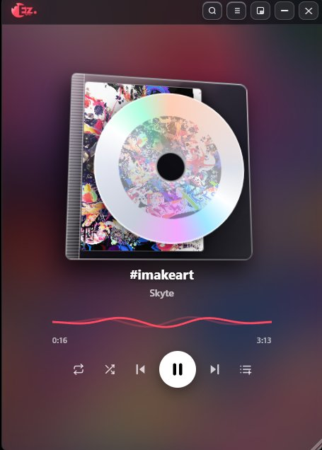
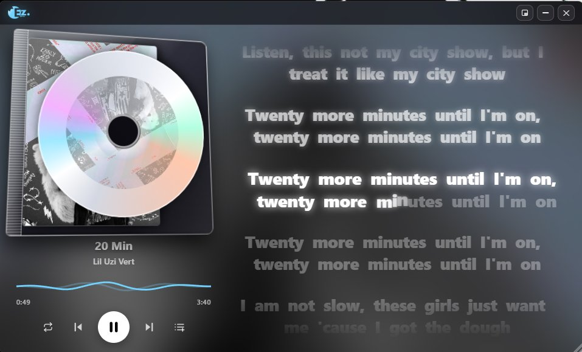
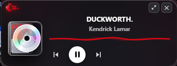

<div align="center">
  
  <h1>EZ Lyrics Player</h1>
  <p><strong>A lightweight, fast lyrics player based on Python.</strong></p>
</div>

EZ Lyrics Player is a fast, standalone desktop music player and real-time synchronized lyrics display. It streams songs and time-synced lyrics with minimal CPU and RAM usage, running completely independent of Spotify.

## Showcase

| Vertical Player | Real-Time Synced Lyrics | Mini HUD Mode |
|---|---|---|
|  |  |  |

### Video Previews
- [Full Playback & Lyrics Demo](https://files.catbox.moe/otukqh.mp4)
- [Search, Playlists & Controls Demo](https://files.catbox.moe/28o6mf.mp4)

---

## Features

- **Standalone Playback**: Stream songs directly without opening or needing Spotify.
- **Synced Lyrics**: Millisecond-accurate line-by-line scrolling lyrics.
- **Smart Song Radio**: Skipping a searched song automatically plays similar recommended tracks.
- **Playlist Support**: Click the play badge to start a playlist from track one, or click the row to browse songs.
- **Smooth, reactive UI**: Clean album-art color matching, customizable themes, and drag-and-drop window controls.
- **Shuffle & Loop**: Randomize queue tracks or loop your favorite song.
- **Ghost Mode (`Ctrl+Shift+L`)**: Click right through the window while gaming or working.
- **Low Resource Usage**: Uses under 50 MB of RAM.

---

## How It Works

EZ Lyrics Player retrieves audio streams and synced lyric timestamps concurrently, aligning lines in real time using local audio tracking. Playlists and track data store in a compact `playlists.json` file for instant reloads.

---

## FAQ

**Does this require Spotify?**  
No. It operates completely standalone with zero Spotify background processes.

**How do I play playlists?**  
Click the play button on any playlist to start from the beginning, or click anywhere else on the row to view and pick specific tracks.

**Can I run it without installing Python?**  
Yes. Download the pre-built `EZ.Lyrics.Player.exe` directly from the [Releases](https://github.com/IsthatNyte/ez-lyrics-player/releases) page.

---

## Quick Start

### Option A: Run Pre-Built Executable
Download `EZ.Lyrics.Player.exe` from [Releases](https://github.com/IsthatNyte/ez-lyrics-player/releases) and double-click to launch.

### Option B: Run from Source
```bash
git clone https://github.com/IsthatNyte/ez-lyrics-player.git
cd ez-lyrics-player
pip install -r requirements.txt
python app.py
```
